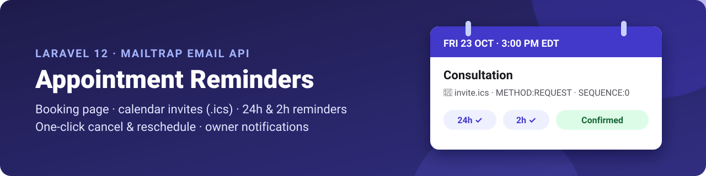
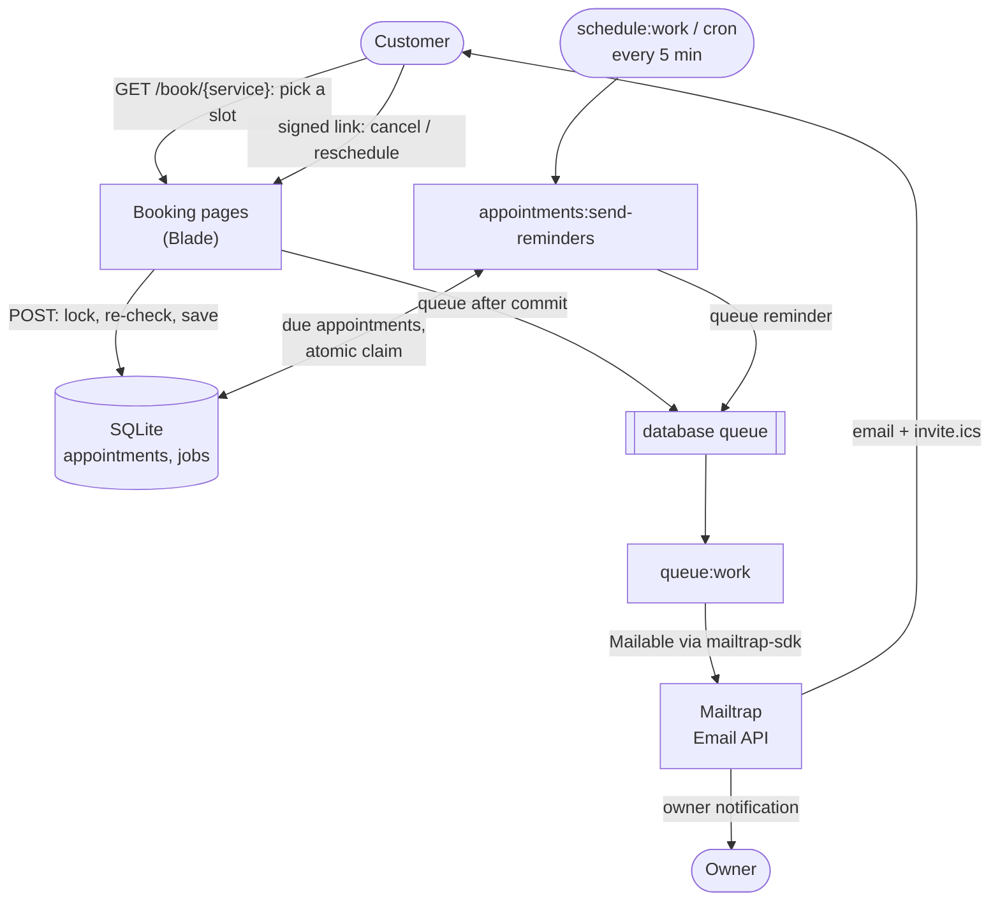
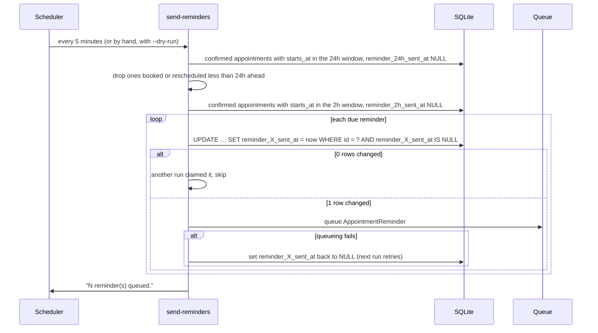

<p align="center">
  
</p>

# Appointment Booking with Calendar Invites and Reminder Emails in Laravel (Mailtrap)

Cut no-shows for any appointment-based business. This Laravel 12 app lets customers book a slot on a public page, then sends a confirmation with a calendar invite, automatic 24-hour and 2-hour reminders, and one-click cancel and reschedule links. Emails go through the Mailtrap Email API using Laravel's own Mail system and the official Mailtrap Laravel bridge.

<p>
  
  
  
  
  
  
</p>

## The problem

No-shows cost appointment businesses real money, and most of them are not rude customers. They forgot, they never got the details, or they could not easily move the booking. Building the fix is harder than it looks: two customers book the same slot, a calendar invite arrives as a loose attachment instead of an event, a reschedule adds a second event next to the old one, a reminder goes out twice, and a failed email breaks the booking itself.

## What this repo solves

A small, complete Laravel app that handles each of those details, ready to read, run and copy into your own project.

| Problem | How this repo handles it |
| --- | --- |
| Double bookings | A cache lock plus a transaction that re-checks the slot before saving. The second customer gets a clear message. |
| Customers forget the appointment | A confirmation with an `.ics` invite, then a 24-hour and a 2-hour reminder |
| Reminders sent twice or at the wrong time | Time windows plus an atomic database claim, so a late scheduler still sends the right one, once |
| Rescheduling creates duplicate calendar events | The same invite `UID` with a higher `SEQUENCE`, so calendars move or remove the existing event |
| Customers can't change their booking | Signed cancel and reschedule links in every email, valid until the appointment starts |
| A failed email breaks the booking | Emails are queued after commit with retries. A queueing failure is logged and the booking still succeeds. |
| Wrong times across time zones and daylight saving | Everything is stored in UTC and shown in the business time zone, with DST-safe slot generation |

**Contents:** [Demo](#demo) · [How it works](#how-it-works) · [Features](#features) · [Stack](#stack) · [Prerequisites](#prerequisites) · [Mailtrap setup](#mailtrap-setup) · [Quick start](#quick-start) · [Screenshots](#screenshots) · [Booking rules](#booking-rules) · [Reminder rules](#reminder-rules) · [Calendar invites](#calendar-invites) · [Cancel and reschedule links](#cancel-and-reschedule-links) · [Key integration points](#key-integration-points) · [Failure behavior](#failure-behavior) · [Security design](#security-design) · [Configuration](#configuration) · [Scheduling and the queue](#scheduling-and-the-queue) · [Time zones](#time-zones) · [Data model](#data-model) · [Project structure](#project-structure) · [Tests](#tests) · [Deploying](#deploying-to-production) · [Limitations](#limitations) · [FAQ](#faq)

## Demo

A real reminder run looks like this (one confirmed appointment that starts in 23 hours):

```text
$ php artisan appointments:send-reminders --dry-run
Dry run at 2026-10-21T06:50:32Z – nothing will be sent.
Would send 24h reminder → John Miller (john.miller@example.com) for Thu 22 Oct, 1:50 AM EDT [b409b7c1-bab0-4efe-ab2f-919593ba7c8f]
1 reminder(s) due.

$ php artisan appointments:send-reminders
Queued 24h reminder → John Miller (john.miller@example.com) for Thu 22 Oct, 1:50 AM EDT [b409b7c1-bab0-4efe-ab2f-919593ba7c8f]
1 reminder(s) queued.

$ php artisan appointments:send-reminders
0 reminder(s) queued.
```

The second real run sends nothing: each reminder is claimed in the database before it's queued. An appointment booked less than 24 hours ahead gets no 24h reminder at all, only the 2h one later. See [Screenshots](#screenshots) for the booking pages and the emails.

## How it works

Customers book on a public page. Every change (book, reschedule, cancel) saves to SQLite inside a locked transaction, then queues emails through Laravel's `database` queue. A queue worker sends them through the Mailtrap bridge's `mailtrap-sdk` transport. The scheduler runs the reminder command every 5 minutes.



| Part | What it does | Where |
| --- | --- | --- |
| Settings | Business details and slot rules from `.env` | `config/booking.php` |
| Mailer | `mailtrap-sdk` mailer for the bridge transport | `config/mail.php`, `config/services.php` |
| Slots | Business hours → free slots, DST-safe, all UTC | `app/Services/AvailabilityService.php` |
| Booking | Book, reschedule, cancel under a lock; queue emails safely | `app/Services/AppointmentManager.php` |
| Calendar | `.ics` REQUEST/CANCEL with a stable UID and SEQUENCE | `app/Services/IcsBuilder.php` |
| Emails | Five Mailables sharing one queued base class | `app/Mail/` |
| Reminders | Window check, atomic claim, queue | `app/Console/Commands/SendAppointmentReminders.php` |
| Schedule | Every 5 minutes, without overlapping | `routes/console.php` |
| Pages | Public booking, signed cancel and reschedule | `app/Http/Controllers/`, `resources/views/` |
| Templates | HTML and plain text for each email | `resources/views/emails/` |

### Booking to reminders

1. The customer opens `GET /book/{service}`, picks a day and a time, and fills in name, email and phone.
2. The browser posts the form to `POST /book/{service}`. The request is validated and throttled to 10 a minute per IP.
3. `AppointmentManager::book()` takes the cache lock `appointments:write` and re-checks that the slot is still free inside a transaction.
4. If it's free, the appointment is saved in UTC with `sequence` 0 and the transaction commits. If not, the customer goes back to the picker with a clear message.
5. After the commit, the confirmation (with `invite.ics`) and the owner notification are queued. If queueing throws, it is logged and the booking still succeeds.
6. The customer lands on a signed confirmation page.
7. `queue:work` picks up the jobs and sends them through the Mailtrap bridge, with 3 tries.
8. Mailtrap delivers the email. The customer can use its signed links to cancel or reschedule.
9. Every 5 minutes the scheduler runs `appointments:send-reminders`. For each reminder that is due it claims the row with a conditional `UPDATE … WHERE reminder_*_sent_at IS NULL`.
10. Only the run that changed the row queues the reminder, so it is never sent twice.

### One booking, step by step

```mermaid
sequenceDiagram
    participant C as Customer
    participant B as BookingController
    participant M as AppointmentManager
    participant D as SQLite
    participant Q as Queue worker
    participant T as Mailtrap

    C->>B: POST /book/consultation (name, email, phone, starts_at)
    B->>B: validate (FormRequest), throttle 10/min
    B->>M: book()
    M->>M: take cache lock "appointments:write"
    M->>D: BEGIN; re-check slot is still free
    alt slot taken
        M-->>B: SlotUnavailableException
        B-->>C: back to the slot picker: "That slot was just taken, please pick another."
    else free
        M->>D: INSERT appointment (UTC, sequence 0, booked_at); COMMIT
        M->>D: queue AppointmentConfirmed + OwnerBookingNotification
        Note over M,D: if queueing throws, log it – the booking still succeeds
        B-->>C: redirect to signed confirmation page
        Q->>D: pick up jobs
        Q->>T: confirmation (+ invite.ics) and owner email
    end
```

### One reminder run, step by step



## Features

- **Public booking page.** Customers pick a service, a date from the next 30 days and a free time, then enter their name, email and phone. Closed days show a short message instead of times.
- **Real availability.** Slots follow business hours, a fixed interval, the service's length (it must end by closing time), a minimum notice period and every confirmed appointment, across all services.
- **No double booking.** An atomic cache lock plus a transaction that re-checks the slot before saving. The second customer gets "That slot was just taken, please pick another."
- **Confirmation with a calendar invite.** `invite.ics` (`METHOD:REQUEST`) shows an "Add to calendar" button in Gmail, Apple Mail and Outlook.
- **24-hour and 2-hour reminders.** Sent by a scheduled command. Bookings made less than 24 hours ahead skip the 24h one. A late scheduler still sends the right reminder, and a reminder is never sent twice.
- **One-click cancel and reschedule.** Signed links in every customer email, valid until the appointment starts. Calendars move or remove the original event instead of adding a second one.
- **Owner notifications.** New, rescheduled (old → new time) and cancelled bookings, with the customer as reply-to.
- **Timezone-correct.** Everything is stored in UTC and shown in the business timezone, with `EDT`/`EST` style abbreviations. Daylight saving changes are handled.
- **One Mailtrap category per email type,** so you can split delivery stats in Mailtrap.
- **Email never blocks a booking.** Emails are queued with 3 tries. A failure to queue one is logged, and the booking still succeeds.
- **A polished, accessible booking UI.**
  - a blue page with a navy side panel that shows the service, its length and the location
  - a scrolling date strip with closed days greyed out, and time chips for the free slots
  - a two-column form for name, phone and email, with errors shown under each field
  - matching confirmation, reschedule and cancel pages
  - plain, mostly-text emails with one button
  - keyboard focus styles, a disabled button while submitting, and layouts that work down to a phone
- **Fully tested without a network.** 87 Pest tests with `Mail::fake()`, `Queue::fake()` and time travel.

## Stack

| | |
| --- | --- |
| Language | PHP 8.3 |
| Framework | Laravel 12, Blade views, one plain CSS file and a few lines of inline script (no JS framework, no Vite build needed) |
| Database and queue | SQLite, `database` queue driver |
| Calendar | [`spatie/icalendar-generator`](https://github.com/spatie/icalendar-generator) |
| Email | [`railsware/mailtrap-php`](https://github.com/railsware/mailtrap-php) with its Laravel bridge, plus `symfony/http-client` and `nyholm/psr7` |
| Tests | Pest 4 |

Those four Composer packages are the only additions to the Laravel skeleton (plus Pest for development). There are no npm packages beyond Laravel's defaults, and nothing needs building.

## Prerequisites

- PHP 8.3 with the `pdo_sqlite`, `mbstring` and `curl` extensions, and Composer.
- A [Mailtrap](https://mailtrap.io) account. The free plan is enough to try it out.
- Something to keep two processes running: a queue worker and the scheduler (or a cron entry).

## Mailtrap setup

1. **Create an API token.** In Mailtrap, go to **Settings → API Tokens** and create a token with sending access. Put it in `.env` as `MAILTRAP_API_KEY`.
2. **Use the bridge's variables.** These are the exact lines from the [Mailtrap Laravel bridge README](https://github.com/railsware/mailtrap-php/tree/main/src/Bridge/Laravel):

   ```dotenv
   MAIL_MAILER="mailtrap-sdk"

   MAILTRAP_HOST="send.api.mailtrap.io"
   MAILTRAP_API_KEY="YOUR_API_KEY_HERE"
   ```

3. **Try it on the demo domain first.** New accounts get a demo sending domain, `demomailtrap.co`. Set `MAIL_FROM_ADDRESS="hello@demomailtrap.co"` and book using **the email address you signed up to Mailtrap with**. Things to know:
   - The demo domain only delivers to the Mailtrap account owner. Sending to anyone else fails with `403: Demo domains can only be used to send emails to account owners`. The same applies to `OWNER_EMAIL`.
   - The demo domain has a small sending allowance. Once it's used up, every send fails with `403: Sending usage of this domain has reached its limit`.
   - Mail from a shared demo domain can land in spam, so check there for the first email.
4. **Verify your own domain to email real customers.** Go to **Sending Domains → Add domain** and create the DNS records Mailtrap shows (SPF, DKIM, DMARC). When the domain shows as verified, set `MAIL_FROM_ADDRESS` to an address on it.
5. **Prefer a test inbox?** Use the sandbox: `MAILTRAP_HOST="sandbox.api.mailtrap.io"` and `MAILTRAP_INBOX_ID=<your inbox id>`. Every email then lands in your Mailtrap inbox, whoever it's addressed to.
6. Run `php artisan config:clear` after changing any of these, and restart `queue:work`.

## Quick start

```bash
git clone https://github.com/manishgupta412/laravel-appointment-reminders.git && cd laravel-appointment-reminders
composer install

cp .env.example .env                   # then fill it in (see Configuration)
php artisan key:generate
touch database/database.sqlite
php artisan migrate --seed             # 3 services + business hours
```

Then keep these three running, each in its own terminal:

```bash
php artisan serve          # the booking site on http://localhost:8000
php artisan queue:work     # sends the queued emails
php artisan schedule:work  # runs the reminder command every 5 minutes
```

Open **http://localhost:8000**, pick a service and a slot, and book with your own email address. Open `localhost`, not `127.0.0.1`: links in emails are signed for `APP_URL`, and the host is part of the signature.

`php artisan db:seed` is safe to run again; it updates the services and hours instead of duplicating them.

| Seeded service | Length |
| --- | --- |
| Quick Call | 15 min |
| Consultation | 30 min |
| Session | 60 min |

### What you'll see in the terminal

**The server and the scheduler started**

```text
$ php artisan serve

   INFO  Server running on [http://127.0.0.1:8000].

  Press Ctrl+C to stop the server

$ php artisan schedule:work

   INFO  Running scheduled tasks.
```

**The queue worker after a booking:** the confirmation to the customer and the notification to the owner.

```text
$ php artisan queue:work
  2026-10-21 06:50:29 App\Mail\AppointmentConfirmed .................. RUNNING
  2026-10-21 06:50:29 App\Mail\AppointmentConfirmed ............. 25.77ms DONE
  2026-10-21 06:50:29 App\Mail\OwnerBookingNotification .............. RUNNING
  2026-10-21 06:50:29 App\Mail\OwnerBookingNotification .......... 1.46ms DONE
```

**Force the reminders to send** (for testing) by moving your latest booking into a reminder window:

```bash
# 24h reminder: starts in 23 hours, booked 2 days ago
php artisan tinker --execute='App\Models\Appointment::latest("id")->first()->update(["starts_at"=>now()->addHours(23),"ends_at"=>now()->addHours(23)->addMinutes(30),"booked_at"=>now()->subDays(2),"reminder_24h_sent_at"=>null,"reminder_2h_sent_at"=>null]);'
php artisan appointments:send-reminders

# 2h reminder: starts in 90 minutes
php artisan tinker --execute='App\Models\Appointment::latest("id")->first()->update(["starts_at"=>now()->addMinutes(90),"ends_at"=>now()->addMinutes(120),"reminder_2h_sent_at"=>null]);'
php artisan appointments:send-reminders
```

## Screenshots

<p align="center">
  <em>Screenshot to add: <code>docs/screenshots/page-2-booking.png</code> (the booking page with a date and time picked)</em><br>
  <em>Screenshot to add: <code>docs/screenshots/page-3-appointment.png</code> (the "You're booked!" page)</em>
</p>
<p align="center">Pick a day and a time, enter your details, and land on a confirmation page with a Reschedule and a Cancel button.</p>

<p align="center">
  <em>Screenshot to add: <code>docs/screenshots/01-confirmation-consultation.png</code> (the confirmation email)</em><br>
  <em>Screenshot to add: <code>docs/screenshots/04-reminder-24h.png</code> (the 24-hour reminder)</em>
</p>
<p align="center">The confirmation carries <code>invite.ics</code>. Every customer email has a Reschedule button and a Cancel link.</p>

The screenshots will show the real pages and templates, rendered with sample data in `America/New_York`. On the email screenshots, the strip at the top shows the subject, sender, recipient, Mailtrap category and attachment; it isn't part of the email. Every email also has a plain-text version.

## Booking rules

Slots are generated per request by `AvailabilityService::slotsFor()`:

1. **Bookable dates.** Today through `BOOKING_MAX_DAYS_AHEAD − 1` days ahead, in the business timezone. Other dates return no slots.
2. **Business hours.** One open/close range per weekday, stored as local times. Seeded: Mon–Fri 09:00–18:00, Sat 10:00–14:00, Sun closed.
3. **Interval.** Slots start every `BOOKING_SLOT_INTERVAL_MINUTES` from opening time.
4. **Must fit.** The slot plus the service's length must end by closing time. A 60-minute Session's last slot is 17:00; a 30-minute Consultation's is 17:30.
5. **Minimum notice.** A slot must start at least `BOOKING_MIN_NOTICE_MINUTES` from now.
6. **No overlap.** A slot is free only if it overlaps no confirmed appointment of any service: `start < other_end AND end > other_start`. Back-to-back is fine. Cancelled appointments don't block anything.

The POST handler doesn't trust the submitted time: it must be one of the slots that the same function returns at save time, so a hand-crafted `starts_at` (off-interval, closed day, in the past) is rejected the same way as a taken slot.

## Reminder rules

| Reminder | Sent when | Skipped when | Category | Subject |
| --- | --- | --- | --- | --- |
| 24h | `starts_at − 24h ≤ now < starts_at − 2h` | Booked or rescheduled less than 24h before the start | `appointment-reminder-24h` | `Reminder: tomorrow – Consultation on Fri 23 Oct, 3:00 PM EDT` |
| 2h | `starts_at − 2h ≤ now < starts_at` | – | `appointment-reminder-2h` | `Starting soon – Consultation on Fri 23 Oct, 3:00 PM EDT` |

How a run decides:

1. **Only confirmed appointments.** Cancelled ones never get reminders. If an appointment is cancelled after its reminder was queued, the reminder is dropped when the worker picks it up.
2. **Windows, not exact times.** If the scheduler was down, the next run still sends whichever reminder is currently due. A missed 24h reminder is never sent once the 2h point has passed, so a customer never gets both at once.
3. **Short-notice bookings.** If the slot was chosen less than 24 hours before it starts, there is no 24h reminder, only the 2h one.
4. **Claim, then queue.** `UPDATE appointments SET reminder_24h_sent_at = now WHERE id = ? AND reminder_24h_sent_at IS NULL`. Only the run that changed the row queues the email, so repeated or concurrent runs never send twice.
5. **Reschedule resets.** Both `*_sent_at` columns go back to `NULL`, and the reschedule time counts as the new booking time for rule 3.

Example: an appointment on Friday 23 October at 3:00 PM EDT, booked on 19 October, with the scheduler running every 5 minutes.

| Run (EDT) | Sends |
| --- | --- |
| Thu 22 Oct, 3:00 PM | 24h reminder |
| Fri 23 Oct, 1:00 PM | 2h reminder |
| any other run | nothing |

The other emails:

| Email | To | Category | Subject |
| --- | --- | --- | --- |
| Confirmation (+ `invite.ics`) | customer | `appointment-confirmation` | `Confirmed: Consultation on Fri 23 Oct, 3:00 PM EDT` |
| Rescheduled (+ `invite.ics`) | customer | `appointment-reschedule` | `Rescheduled: Consultation moved to Sat 24 Oct, 12:00 PM EDT` |
| Cancelled (+ `cancel.ics`) | customer | `appointment-cancellation` | `Cancelled: Session on Mon 26 Oct, 11:00 AM EDT` |
| Owner notification | `OWNER_EMAIL` | `owner-notification` | `New booking: …` · `Rescheduled: …` · `Cancelled: … with John Miller on …` |

## Calendar invites

Calendar apps match an invite to an existing event by its **UID**, then use **METHOD** and **SEQUENCE** to decide what to do:

| Event | METHOD | UID | SEQUENCE | STATUS | In the customer's calendar |
| --- | --- | --- | --- | --- | --- |
| Booked | `REQUEST` | `{uuid}@your-host` | `0` | `CONFIRMED` | Event added |
| Rescheduled | `REQUEST` | **same** | `1`, `2`, … | `CONFIRMED` | Existing event **moved** |
| Cancelled | `CANCEL` | **same** | previous + 1 | `CANCELLED` | Existing event **removed** |

- The UID is a UUID generated when the appointment is created and never changed. The host part comes from `APP_URL`.
- SEQUENCE goes up by one on every change. Calendars ignore an update whose SEQUENCE is lower than the one they already have.
- The attachment's MIME type is `text/calendar; charset=UTF-8; method=REQUEST` (or `method=CANCEL`). That's what makes mail clients show invite buttons instead of a plain file.
- `DTSTART`/`DTEND` are UTC with a `Z` suffix (`DTSTART:20261023T190000Z`). Every client converts them to the viewer's own time, so no `VTIMEZONE` block is needed.
- The invite also carries `ORGANIZER` (`MAIL_FROM_ADDRESS`, named after `BUSINESS_NAME`), `ATTENDEE;RSVP=FALSE` (the customer), `LOCATION` (`BUSINESS_ADDRESS`), `DTSTAMP`, `LAST-MODIFIED`, and a `DESCRIPTION` with the cancel and reschedule links.

A confirmation's invite, as generated (line folding removed, signatures shortened). With no `BUSINESS_NAME` set, the name falls back to `APP_NAME`:

```text
BEGIN:VCALENDAR
VERSION:2.0
PRODID:-//Appointment Reminders//Appointments//EN
METHOD:REQUEST
CALSCALE:GREGORIAN
BEGIN:VEVENT
UID:16f10d82-66a1-47b5-a3a1-627ea0c7cf8a@localhost
DTSTAMP:20261021T065255Z
DTSTART:20261022T143000Z
DTEND:20261022T150000Z
SUMMARY:Consultation with Appointment Reminders
DESCRIPTION:Consultation with Appointment Reminders\nWhen: Thursday 22 October 2026\, 10:30 AM EDT\n\nNeed to cancel? http://localhost:8000/appointments/16f10d82-66a1-47b5-a3a1-627ea0c7cf8a/cancel?expires=1792679400&signature=365646…\nNeed to reschedule? http://localhost:8000/appointments/16f10d82-66a1-47b5-a3a1-627ea0c7cf8a/reschedule?expires=1792679400&signature=886b5a…
STATUS:CONFIRMED
LOCATION:350 5th Ave\, New York\, NY 10118\, USA
ORGANIZER;CN=Appointment Reminders:MAILTO:appointments@your-verified-domain.com
SEQUENCE:0
LAST-MODIFIED:20261021T065132Z
ATTENDEE;CN=John Miller;ROLE=REQ-PARTICIPANT;RSVP=FALSE:MAILTO:john.miller@example.com
END:VEVENT
END:VCALENDAR
```

## Cancel and reschedule links

| Route | Method | What it does |
| --- | --- | --- |
| `/appointments/{uid}` | GET | Appointment details with Reschedule and Cancel buttons |
| `/appointments/{uid}/cancel` | GET | "Cancel this appointment?" page. **Never cancels.** |
| `/appointments/{uid}/cancel` | POST | Cancels: status `cancelled`, SEQUENCE + 1, `cancel.ics`, owner notified |
| `/appointments/{uid}/reschedule` | GET | Slot picker for the same service; its own current slot is marked and doesn't block itself |
| `/appointments/{uid}/reschedule` | POST | Moves it: new times, SEQUENCE + 1, reminders reset, updated `invite.ics`, owner notified |

- Every route uses Laravel's `signed` middleware. Links are made with `URL::temporarySignedRoute()` and **expire when the appointment starts**.
- A tampered, missing or expired signature returns **403** with a friendly page (`resources/views/errors/403.blade.php`).
- GET requests never change anything, because email security scanners open links before the customer does. The signed URL itself is the form's action for the POST.
- An appointment that's already cancelled, or has already started, shows a short message and offers nothing to click.
- POST routes are rate-limited (`throttle:10,1`), and all forms carry a CSRF token.

## Key integration points

**Mailtrap as a Laravel mailer.** The bridge's service provider is auto-discovered and registers the `mailtrap-sdk` transport. One entry in `config/mail.php` makes it a normal mailer ([`config/mail.php`](config/mail.php)):

```php
'mailers' => [
    'mailtrap-sdk' => [
        'transport' => 'mailtrap-sdk',
    ],
    // …
],
```

**A category on every email.** The bridge reads Mailtrap's category from a `CategoryHeader`, added in the envelope's `using` callback ([`app/Mail/AppointmentMailable.php`](app/Mail/AppointmentMailable.php)):

```php
public function envelope(): Envelope
{
    return new Envelope(
        subject: $this->subjectLine(),
        using: [
            // Mailtrap accepts exactly one category per email.
            fn (Email $email) => $email->getHeaders()->add(new CategoryHeader($this->category())),
        ],
    );
}
```

**Queued after commit, with retries.** Every Mailable extends one base class:

```php
abstract class AppointmentMailable extends Mailable implements ShouldQueueAfterCommit
{
    use Queueable, SerializesModels;

    public $tries = 3;

    public $backoff = [60, 300, 900];

    public function failed(Throwable $exception): void
    {
        Log::error('Appointment email failed after all retries', [/* … */]);
    }
}
```

**The invite as an attachment** ([`app/Mail/AppointmentConfirmed.php`](app/Mail/AppointmentConfirmed.php)):

```php
public function attachments(): array
{
    return [
        Attachment::fromData(fn () => app(IcsBuilder::class)->request($this->appointment), 'invite.ics')
            ->withMime('text/calendar; charset=UTF-8; method=REQUEST'),
    ];
}
```

**METHOD, SEQUENCE and RSVP with spatie/icalendar-generator.** The package has no API for `METHOD`, leaves `SEQUENCE` out when it's 0, and can't write `RSVP=FALSE`, so [`IcsBuilder`](app/Services/IcsBuilder.php) appends them as raw properties:

```php
$event
    ->appendProperty(TextProperty::create('SEQUENCE', (string) $appointment->sequence))
    ->appendProperty(
        CalendarAddressProperty::create('ATTENDEE', new CalendarAddress($appointment->customer_email, $appointment->customer_name))
            ->addParameter(Parameter::create('RSVP', 'FALSE'))
    );

return Calendar::create()
    ->withoutAutoTimezoneComponents()
    ->appendProperty(TextProperty::create('METHOD', $method))   // REQUEST or CANCEL
    ->event($event)
    ->get();
```

**No double booking.** A global lock serialises writes (SQLite has no `SELECT … FOR UPDATE`), and availability is checked again inside the transaction ([`app/Services/AppointmentManager.php`](app/Services/AppointmentManager.php)):

```php
return Cache::lock('appointments:write', 10)->block(5, fn () => DB::transaction(function () use ($service, $customer, $startsAt) {
    if (! $this->availability->isAvailable($service, $startsAt)) {
        throw new SlotUnavailableException;   // "That slot was just taken, please pick another."
    }

    return Appointment::create([/* … */]);
}));
```

**Never send a reminder twice.** The conditional `UPDATE` is the lock ([`SendAppointmentReminders.php`](app/Console/Commands/SendAppointmentReminders.php)):

```php
$claimed = Appointment::query()
    ->whereKey($appointment->getKey())
    ->whereNull($column)                 // reminder_24h_sent_at or reminder_2h_sent_at
    ->where('status', AppointmentStatus::Confirmed)
    ->toBase()
    ->update([$column => $now]);

if ($claimed !== 1) {
    return false;                        // another run got here first
}

Mail::to($appointment->customer_email)->queue(new AppointmentReminder($appointment, $type));
```

## Failure behavior

| Situation | What happens |
| --- | --- |
| The slot was taken after the page loaded | Back to the slot picker with "That slot was just taken, please pick another." Nothing is saved. |
| Two customers submit the same slot at once | The lock lets one in; the other gets the same message. |
| The lock can't be taken within 5 seconds | "We are busy handling another booking, please try again." |
| Queueing an email throws (for example, the `jobs` table is unavailable) | The booking, reschedule or cancellation is still saved. The error is logged as `Failed to queue appointment email`. |
| Mailtrap rejects an email or times out | The queue worker tries 3 times in total, waiting 1 minute and then 5 minutes. After that, `failed()` logs it and the job lands in `failed_jobs`. |
| `MAILTRAP_API_KEY` is empty or wrong | Every send fails with `401 Unauthorized` and follows the row above. Bookings still work. |
| Queueing a reminder fails | The claim is released (`*_sent_at` back to `NULL`) and the next run retries it. |
| The process crashes between claiming and queueing a reminder | The reminder is **not** retried. Missing a reminder is better than sending it twice. |
| An appointment is cancelled after its reminder was queued | The worker drops the reminder instead of sending it. |
| The scheduler was down | The next run sends whichever reminder is currently due; a missed 24h reminder is never sent after the 2h point. |
| A link was tampered with, has no signature, or has expired | `403` with a friendly page. Nothing changes. |
| A cancel link is opened by an email scanner | Only the "Cancel this appointment?" page is shown. Cancelling needs a POST. |
| The appointment is already cancelled or has started | A short message, and no buttons. |
| Rescheduling into a taken slot | An error on the slot picker. Nothing changes and no emails go out. |
| `OWNER_EMAIL` is empty | Owner notifications are skipped. Customer emails are unaffected. |
| Links in emails return `403` locally | `APP_URL` doesn't match the address in the browser (for example `127.0.0.1` vs `localhost`). The host is part of the signature. |
| More than 10 POSTs a minute from one IP | `429` with a friendly page. |
| `403: Demo domains can only be used to send emails to account owners` | You're on `demomailtrap.co` and the recipient isn't the Mailtrap account owner. See [Mailtrap setup](#mailtrap-setup). |
| `403: Sending usage of this domain has reached its limit` | The demo domain's allowance is used up. Verify your own domain. |

## Security design

| Threat | Mitigation |
| --- | --- |
| Someone changing another customer's booking | Cancel and reschedule need a signed URL. Tampering with the id, the expiry or the signature returns `403`. |
| Links that live forever | Signed links expire when the appointment starts. After that, a short message is shown and nothing can be changed. |
| Email scanners using up a cancel link | `GET` only shows a confirmation page. Cancelling needs a `POST`. |
| Double booking by two requests at once | A cache lock plus a transaction that re-checks the slot, so only one request wins |
| A hand-crafted time in the form | The submitted `starts_at` must be one of the slots the server generates at save time |
| Form spam | `throttle:10,1` on every `POST`, and server-side validation of every field |
| Cross-site forged requests | Laravel's CSRF token on every form |
| Cross-site scripting | Blade escapes all output, and the calendar library escapes the `.ics` text |
| A reminder sent twice | An atomic conditional `UPDATE` claims each reminder before it is queued |
| Leaking secrets | The Mailtrap key lives only in `.env`, which is git-ignored |

**Trade-offs to know about:**

- **The link is the credential.** There are no customer accounts, so anyone who has a forwarded email can cancel or reschedule until the appointment starts.
- **Throttling is per IP.** `throttle:10,1` limits one address. Behind a proxy, configure trusted proxies so Laravel sees the real client IP.
- **No bounce handling.** Mailtrap webhooks aren't processed, so a bad address keeps getting emails.
- **The phone number is required but unchecked.** It is stored and shown to the owner, and never verified.

## Configuration

### Environment variables

Copy `.env.example` to `.env`. Mailtrap is configured **only** through these variables.

| Variable | Required | Purpose |
| --- | --- | --- |
| `MAIL_MAILER` | yes | `mailtrap-sdk`, the bridge's transport |
| `MAILTRAP_HOST` | yes | `send.api.mailtrap.io`; `sandbox.api.mailtrap.io` for a test inbox |
| `MAILTRAP_API_KEY` | yes | Mailtrap API token with sending access |
| `MAILTRAP_INBOX_ID` | sandbox only | Your sandbox inbox ID |
| `MAIL_FROM_ADDRESS` | yes | Sender, on a verified domain (or `demomailtrap.co` for testing). Also the invite's ORGANIZER. |
| `MAIL_FROM_NAME` | | Sender name. Defaults to `APP_NAME`. |
| `APP_URL` | yes | Base for signed links; its host is also the iCal UID's domain. Default `http://localhost:8000`. |
| `APP_TIMEZONE` | | Keep `UTC`. All storage is UTC. |
| `BUSINESS_NAME` | | Shown on pages, in emails and in the invite title. Defaults to `APP_NAME`. |
| `BUSINESS_TIMEZONE` | | Default `America/New_York`. Any IANA zone, e.g. `America/Chicago`, `America/Los_Angeles`. |
| `BUSINESS_ADDRESS` | | Email footer, the booking page's location and the invite's LOCATION. The page shows "Video call" when it's empty. |
| `OWNER_EMAIL` | | Receives owner notifications. Empty turns them off. |
| `BOOKING_SLOT_INTERVAL_MINUTES` | | Default `30` |
| `BOOKING_MIN_NOTICE_MINUTES` | | Default `60` |
| `BOOKING_MAX_DAYS_AHEAD` | | Default `30`, including today |
| `DB_CONNECTION` | | `sqlite` |
| `QUEUE_CONNECTION` | | `database` |

### Services and business hours

They live in the `services` and `business_hours` tables. Edit [`database/seeders/ServiceSeeder.php`](database/seeders/ServiceSeeder.php) and [`database/seeders/BusinessHourSeeder.php`](database/seeders/BusinessHourSeeder.php) and run `php artisan db:seed`, or change the rows directly. Hours are local wall-clock strings such as `09:00`, with weekday `0` = Sunday. Set `is_active = false` to hide a service.

## Scheduling and the queue

```text
php artisan appointments:send-reminders [--dry-run]
```

- **`--dry-run`** prints what's due, sends nothing and writes nothing.
- The command is scheduled every 5 minutes in [`routes/console.php`](routes/console.php) with `->withoutOverlapping()`. Extra runs are harmless.

**Locally**, `php artisan schedule:work` runs the scheduler and `php artisan queue:work` sends the emails.

**In production**, run the scheduler from cron:

```cron
* * * * * cd /path/to/laravel-appointment-reminders && php artisan schedule:run >> /dev/null 2>&1
```

…and keep a queue worker running with Supervisor (`/etc/supervisor/conf.d/appointments-worker.conf`):

```ini
[program:appointments-worker]
process_name=%(program_name)s_%(process_num)02d
command=php /path/to/laravel-appointment-reminders/artisan queue:work database --sleep=3 --max-time=3600
autostart=true
autorestart=true
stopasgroup=true
killasgroup=true
user=www-data
numprocs=1
redirect_stderr=true
stdout_logfile=/path/to/laravel-appointment-reminders/storage/logs/worker.log
stopwaitsecs=3600
```

```bash
sudo supervisorctl reread && sudo supervisorctl update && sudo supervisorctl start "appointments-worker:*"
```

Run `php artisan queue:restart` after every deploy. `php artisan queue:failed` lists failed emails and `php artisan queue:retry all` retries them.

## Time zones

- **Storage is UTC.** `APP_TIMEZONE=UTC`; `starts_at`, `ends_at` and every other timestamp are UTC in the database.
- **Display is the business timezone.** Pages and emails convert to `BUSINESS_TIMEZONE` and show the abbreviation: `3:00 PM EDT` in summer, `3:00 PM EST` in winter.
- **Slots are DST-safe.** Each day's opening and closing times are turned into exact UTC instants first, and slots are stepped in UTC. On a clock-change day there are no duplicate or missing slots, and every slot is exactly *interval* minutes after the previous one.
- **Invites are UTC.** Customers in another timezone see the appointment in their own local time in their calendar app.

Example with `BUSINESS_TIMEZONE=America/New_York`:

| Business-hours slot | Stored (UTC) | Shown |
| --- | --- | --- |
| Fri 23 Oct, 09:00 | `2026-10-23 13:00:00` | 9:00 AM EDT |
| Mon 2 Nov, 09:00 (after DST ends) | `2026-11-02 14:00:00` | 9:00 AM EST |

## Data model

| Table | Key fields |
| --- | --- |
| `services` | `name`, `slug` (unique, used in URLs), `duration_minutes`, `description`, `is_active` |
| `business_hours` | `weekday` (0–6, unique), `opens_at`, `closes_at` (local `HH:MM`), `is_closed` |
| `appointments` | `uid` (UUID, unique, never changes), `service_id`, `customer_name`, `customer_email`, `customer_phone`, `starts_at`, `ends_at` (UTC), `status` (`confirmed` · `cancelled`), `sequence` (default 0), `reminder_24h_sent_at`, `reminder_2h_sent_at`, `booked_at`, `rescheduled_at`, `cancelled_at`. Indexed on `(starts_at, status)`. |
| `jobs`, `failed_jobs` | Laravel's database queue |

`rescheduled_at` is the latest time the customer moved the appointment. The 24h rule uses it in place of `booked_at`, so the original booking time is kept.

## Project structure

```text
.
├── .github/workflows/tests.yml          Pest on PHP 8.3, on push and PR
├── app/
│   ├── Console/Commands/
│   │   └── SendAppointmentReminders.php windows, atomic claim, --dry-run
│   ├── Enums/AppointmentStatus.php
│   ├── Exceptions/                      SlotUnavailable, AppointmentNotChangeable
│   ├── Http/
│   │   ├── Controllers/                 Service, Booking, Appointment (signed)
│   │   └── Requests/                    BookAppointment, RescheduleAppointment
│   ├── Mail/                            AppointmentMailable (base) + 5 Mailables
│   ├── Models/                          Appointment, Service, BusinessHour
│   └── Services/
│       ├── AvailabilityService.php      slot generation, DST-safe, UTC
│       ├── AppointmentManager.php       book, reschedule, cancel under a lock
│       └── IcsBuilder.php               REQUEST / CANCEL invites
├── config/
│   ├── booking.php                      business settings from .env
│   ├── mail.php                         + mailtrap-sdk mailer
│   └── services.php                     + mailtrap-sdk credentials
├── database/
│   ├── migrations/                      services, business_hours, appointments
│   └── seeders/                         3 services, weekly hours
├── docs/                                banner and screenshots
├── public/css/app.css                   the only stylesheet
├── resources/views/
│   ├── layouts/app.blade.php            page shell, footer, submit-button script
│   ├── services/, booking/, appointments/
│   ├── partials/                        aside (side panel), art (illustration), date-picker, slot-picker
│   ├── emails/                          layout, html/, text/, partials/
│   └── errors/                          403, 404, 419, 429
├── routes/
│   ├── web.php                          public + signed routes
│   └── console.php                      schedule
└── tests/Feature/                       Pest suites (no network)
```

## Tests

```bash
./vendor/bin/pest      # or: php artisan test
```

The suite has 87 tests. They need no `.env` values, no credentials and no network: `phpunit.xml` sets test values, mail goes to `Mail::fake()` or Laravel's in-memory `array` mailer, and time is controlled with `$this->travelTo()`. They pin `BUSINESS_TIMEZONE=Asia/Kolkata` so expected times never depend on your `.env`; a separate test covers `America/New_York` across a DST change.

| File | Covers |
| --- | --- |
| `SlotGenerationTest.php` | Business hours, interval, closing-time fit, Saturday hours, minimum notice, closed day, booking horizon, overlaps across services, cancelled appointments, DST change day |
| `BookingTest.php` | Booking queues the confirmation and owner email; `invite.ics` name, MIME (`method=REQUEST`), `METHOD:REQUEST`, UID, `SEQUENCE:0`, UTC `Z` times; double and overlapping bookings blocked; invalid times; validation; **booking succeeds when sending throws**; rate limit |
| `ReminderTest.php` | 24h at the right time, 2h at the right time, **10h-ahead booking gets no 24h but gets 2h**, late scheduler run, no 24h after the 2h point, nothing after start, **running twice sends once**, a concurrent claim, cancelled appointments, `--dry-run`, reschedule resets and re-evaluates |
| `RescheduleTest.php` | Same UID, `SEQUENCE:1`, new times, reminders reset, updated invite, owner sees old → new, slot freed, taken slot refused, cancelled appointment |
| `CancelTest.php` | GET never cancels; `METHOD:CANCEL`, same UID, higher SEQUENCE, `STATUS:CANCELLED`, `cancel.ics`; slot freed; no reminders afterwards; queued reminder dropped; already cancelled; already started |
| `SignedUrlTest.php` | Valid links work; tampered, changed-expiry, other-appointment and missing signatures → 403; expired at start time → 403 |
| `TimezoneTest.php` | UTC in the database, business time in the email subject and body |
| `MailablesTest.php` | The Mailtrap category on all 8 email variants (exactly one each), HTML + text bodies, `tries`/`backoff`/after-commit on the queued job (`Queue::fake()`), `failed()` logging, owner reply-to, no owner email when `OWNER_EMAIL` is empty |
| `IcsBuilderTest.php` | Every invite property, CANCEL output, UID never changes, `SEQUENCE:0` on a freshly created appointment |

## Deploying to production

- **Environment:** set `APP_ENV=production`, `APP_DEBUG=false`, a generated `APP_KEY` and `APP_URL` to your real `https://` address. Signed links and the invite's UID host come from `APP_URL`.
- **Mailtrap:** verify your sending domain and set `MAIL_FROM_ADDRESS` on it. Keep `MAILTRAP_API_KEY` in the server's environment, not in the repo.
- **Build and migrate:** run `composer install --no-dev --optimize-autoloader`, `php artisan migrate --force`, `php artisan db:seed --force` once, and `php artisan config:cache route:cache view:cache`.
- **Two processes:** keep the scheduler running from cron and a queue worker running under Supervisor, see [Scheduling and the queue](#scheduling-and-the-queue). Run `php artisan queue:restart` after every deploy.
- **Proxy:** behind nginx or a load balancer, configure Laravel's trusted proxies so the per-IP throttle sees the real client IP.
- **Disk:** SQLite needs a persistent disk. To run several servers, move to MySQL or PostgreSQL and use Redis for the cache lock and the queue.
- **Writable folders:** `storage/` and `bootstrap/cache/` must be writable by the web user.

## Limitations

- **One calendar.** All services share one schedule, so only one appointment can happen at a time. There are no staff members, rooms or resources.
- **One opening range per weekday.** No lunch breaks, holidays or one-off closures; close a day by editing `business_hours`.
- **No admin screen.** Services and hours are edited in the seeders or the database. The owner follows bookings by email.
- **No customer accounts.** The signed link is the only credential, so anyone with a forwarded email can cancel or reschedule until the appointment starts.
- **Fixed reminder times.** 24 hours and 2 hours before; changing them means editing the command.
- **Email only.** No SMS or push reminders.
- **No bounce handling.** Mailtrap webhooks aren't processed, so a bad address keeps getting emails.
- **Single server.** SQLite and the database queue are fine for one machine. Use MySQL or PostgreSQL and Redis to scale out.
- **The demo domain only reaches you.** Emailing real customers requires a verified sending domain.

## FAQ

### How do I send appointment reminder emails in Laravel?

Store the start time in UTC with a nullable `reminder_*_sent_at` column per reminder, and schedule an Artisan command every few minutes. It selects appointments whose reminder window is open, claims each one with a conditional `UPDATE … WHERE reminder_24h_sent_at IS NULL`, and queues a Mailable only when exactly one row changed.

Windows cover late scheduler runs, and the claim prevents duplicates. See [Reminder rules](#reminder-rules).

### How do I attach a calendar invite (.ics) to a Laravel email?

Build the iCalendar text, here with `spatie/icalendar-generator`, and return it from the Mailable's `attachments()` method with the calendar MIME type:

```php
Attachment::fromData(fn () => $ics, 'invite.ics')
    ->withMime('text/calendar; charset=UTF-8; method=REQUEST');
```

Include `METHOD:REQUEST`, a stable `UID`, a `SEQUENCE`, UTC times, an `ORGANIZER` and an `ATTENDEE`, so mail clients show it as an invite. See [Calendar invites](#calendar-invites).

### How do I update a calendar event after the customer reschedules?

Send a new `.ics` with the same UID, a higher SEQUENCE and `METHOD:REQUEST` with the new times, and the calendar moves the existing event. To remove it, send `METHOD:CANCEL` and `STATUS:CANCELLED` with the same UID and a higher SEQUENCE.

This app creates the UID once per appointment and increments `sequence` on every reschedule and cancellation.

### How do I use Mailtrap as the mail driver in Laravel?

Install the SDK with a PSR-18 client: `composer require railsware/mailtrap-php symfony/http-client nyholm/psr7`. Add `'mailtrap-sdk' => ['transport' => 'mailtrap-sdk']` to the `mailers` in `config/mail.php`, then set these variables:

```dotenv
MAIL_MAILER="mailtrap-sdk"
MAILTRAP_HOST="send.api.mailtrap.io"
MAILTRAP_API_KEY="YOUR_API_KEY_HERE"
MAIL_FROM_ADDRESS="you@your-verified-domain.com"
```

Every `Mail::to()->send()` and `->queue()` now goes through the Mailtrap Email API.

### Why do my cancel and reschedule links return 403?

Signed URLs include the host. If `APP_URL` is `http://localhost:8000` but you open the site at `http://127.0.0.1:8000`, links from emails won't match. Use the same address in both places.

Links also stop working, on purpose, once the appointment starts.

### Why didn't my test booking get a 24-hour reminder?

Bookings made less than 24 hours before the appointment skip the 24h reminder and get only the 2h one. To test the 24h email, use the `tinker` commands under [Quick start](#quick-start).

### Why does Mailtrap say "Demo domains can only be used to send emails to account owners"?

`demomailtrap.co` only delivers to the email address that owns the Mailtrap account behind your API token. Book with that address, use the sandbox, or verify your own domain.

See [Mailtrap setup](#mailtrap-setup).

## License

[MIT](LICENSE).
